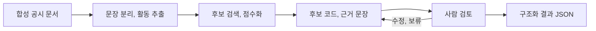

# 합성 공시 형식 문서의 후보와 근거 검토 데모

> 공개용 독립 데모입니다. 외부 LLM과 금융 API를 호출하지 않으며, 실제 기업 프로젝트의 코드와 데이터 또는 모델 성능을 재현하는 자료가 아닙니다.

공개 기업 공시에서 볼 수 있는 문장 형식을 모사한 **합성 문서**를 입력받아 사업 활동을 분리하고, 산업코드 후보와 문장 근거를 제시한 뒤 사람의 검토 결과를 저장하는 포트폴리오용 검토 흐름 데모입니다.

> 실제 기업 프로젝트의 코드, 데이터, 프롬프트, 화면, 업무 규칙과 Git 이력을 복제하지 않았습니다. 회사명, 문서 내용, 산업코드와 점수는 모두 데모를 위해 새로 만든 예시입니다.

## 해결하려는 문제

기업 공시에는 제조, 판매, 연구개발처럼 서로 다른 활동이 한 문단에 함께 기술됩니다. 대표 산업코드 하나만으로는 사업 구조를 충분히 설명하기 어렵고, 모델의 결론만 제시하면 담당자가 오류를 확인하기도 어렵습니다. 이 데모는 다음 과정을 하나의 검토 가능한 흐름으로 연결합니다.

1. 문서를 문장 단위로 분리하고 사업 활동 표현을 추출합니다.
2. 각 활동에 대해 복수 산업코드 후보와 점수를 생성합니다.
3. 후보마다 매칭된 키워드와 근거 문장을 표시합니다.
4. 검토자가 후보를 승인, 수정 또는 보류하고 메모를 남깁니다.
5. 결과를 구조화된 JSON으로 내보내 후속 평가와 재학습에 활용할 수 있게 합니다.

## 내 역할

문제 정의, 공개용 데이터 스키마 설계, 문장 기반 활동 추출, 설명 가능한 후보 생성 로직, 사람 검토 화면, 결과 내보내기, 테스트와 보안 점검을 수행했습니다. 실제 업무에서 배운 문제 구조를 기밀정보 없이 다시 설계한 독립 구현입니다.

## 구조



- `agent.py`: 문장 분리, 활동 추출, 후보 생성과 결과 구조화
- `app.py`: Python 표준 라이브러리 기반 API 및 정적 웹 서버
- `static/`: 문서 입력, 후보 근거 확인, 검토 결과 저장 UI
- `sample_data/`: 허구 기업의 합성 공시 예시
- `tests/`: 추출, 후보 근거, 검토 결과 저장 테스트

## 실행

Python 3.10 이상에서 별도 패키지 설치 없이 실행됩니다.

```bash
git clone https://github.com/kjj403/public-filing-industry-agent-demo.git
cd public-filing-industry-agent-demo
python3 app.py
```

브라우저에서 `http://127.0.0.1:8010`을 엽니다.

```bash
python3 -m unittest discover -s tests -v
```

## 설계 원칙

- **근거 우선**: 모든 후보는 매칭 키워드와 원문 문장을 함께 반환합니다.
- **복수 활동 보존**: 한 문서에서 확인되는 여러 사업을 하나의 대표코드로 압축하지 않습니다.
- **사람 중심 검토**: 자동 결과는 제안이며 최종 결정과 메모를 별도로 기록합니다.
- **재현 가능성**: 외부 LLM이나 API 없이 동일한 입력에 동일한 결과를 반환합니다.
- **공개 안전성**: 합성 문서와 데모용 분류체계만 포함하며 실제 기업정보와 내부 운영정보를 사용하지 않습니다.

## 한계

- 데모용 키워드 검색 모델이며 실제 KSIC 분류 정확도를 보증하지 않습니다.
- PDF, OCR, 표 추출과 실제 DART API 연동은 포함하지 않습니다.
- 인증, 동시 편집, 운영 모니터링과 모델 재학습은 범위 밖입니다.
- 실제 적용 시 공식 분류 해설서, 평가 데이터와 전문가 검수가 추가되어야 합니다.

## 보안 및 공개 범위

- 기존 비공개 저장소나 팀 저장소의 커밋 이력을 가져오지 않았습니다.
- 협업 기업의 데이터, 문서, 화면, 프롬프트, 규칙, API와 접속정보를 포함하지 않습니다.
- 샘플 기업과 공시 문장은 허구이며 코드 체계도 시연용입니다.
- 저장 결과와 환경변수 파일은 Git 추적에서 제외합니다.

## License

[MIT](LICENSE)
